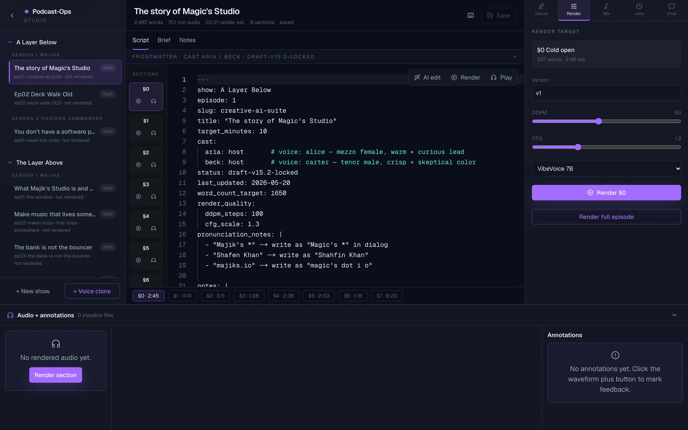
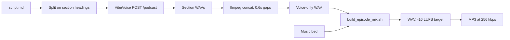
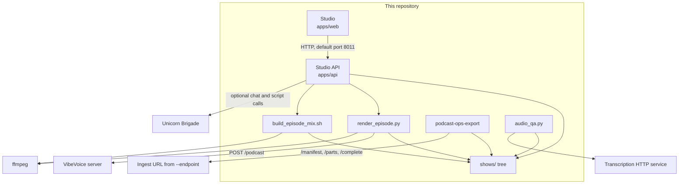

<div align="center">

# Podcast-Ops

A local studio for multi-voice podcast episodes: markdown scripts, speech rendering, a music mix, and AI edits that land only after you approve them.

[](LICENSE)
[](apps/api/pyproject.toml)
[](apps/api/pyproject.toml)
[](apps/api/uv.lock)
[](apps/web/package-lock.json)
[](#quick-start)

[Quick start](#quick-start) · [Features](#feature-tour) · [Agents](#built-for-agents) · [Architecture](#architecture) · [Suite](#part-of-unicorn-commander)

</div>

<p align="center">
  
  <br>
  <em>Episodes view. The show tree and the script for the episode you have open.</em>
</p>

## What is Podcast-Ops?

Podcast-Ops is the production desk for scripted, multi-voice shows. A producer keeps each episode as markdown on disk, renders the spoken sections through a VibeVoice HTTP server, and mixes a music bed into a loudness-normalized WAV and MP3.

It is for people who want the episode files in git and a studio UI on top of them. Chat and script suggestions can go through [Unicorn Brigade](https://github.com/Unicorn-Commander/Unicorn-Brigade). The studio inserts an AI edit into the editor only after you approve it; Save or starting a render writes the edited script to disk. You run the API and the web app yourself. This repository does not share a database with the rest of the suite.

## Highlights

- **The episode is a folder.** Scripts live in episode folders under `shows/`; the API creates `notes.md`, `episode.state.json`, `episode.annotations.jsonl`, and `episode.chat.jsonl` as those features are used. The checkout contains 2 shows, 3 seasons, 8 episode directories, and 7 scripts, so the studio is not empty on first launch.
- **One studio page.** The Next.js app is a single page: show tree, Monaco script editor, waveform player, and an A/B compare view. It talks to the FastAPI app on port 8011 by default.
- **Section rendering.** A render job calls `tools/audio/render_episode.py`, which sends each `## §` section to VibeVoice and concatenates the WAVs with 0.6 seconds of silence. You can re-render selected sections. One render job runs at a time per API process. The queue lives in the API process and is gone when that process exits.
- **A finished mix.** `tools/audio/build_episode_mix.sh` plays an intro, fades the bed down under the opening voice and then to silence, and adds an outro. It applies ffmpeg loudness normalization with targets of −16 LUFS integrated, −1.5 dBTP true peak, and loudness range 11 LU. The API then writes a 256 kbps MP3 next to the WAV.
- **Approval before the script changes.** `POST /ai/script-edit` returns a diff. The studio inserts the returned `edited_script` after you press Approve. Chat history is appended to `episode.chat.jsonl` and does not modify `script.md`.
- **A bearer when you want one.** If `PODCAST_OPS_API_TOKEN` is set, every HTTP route except `GET /health` requires `Authorization: Bearer <token>`. The bundled studio does not send that header, so leave the token unset while you use the UI. The render-log WebSocket is not covered by that HTTP check.
- **Export only the file you named.** [`podcast-ops-export`](tools/exporter/README.md) inventories media, then uploads the exact artifact in your selection file. Script bodies stay on disk. The manifest carries a SHA-256 of `script.md` when that file exists. The bearer is sent to the ingest host, not to object storage.

## Feature tour

The production path is the script, then speech, then a mix.



### Episode library

`GET /shows` scans `shows/<show>/<season>/episodes/` and `shows/<tenant>/<show>/<season>/episodes/`. A directory is a show when one of its children contains `episodes/`; the optional parent directory supplies the tenant label. The tree in this repository sits at `shows/magic-unicorn/`. API lookup uses only the show slug, so use distinct show slugs across tenants.

Each episode row shows a title, slug, status badge, and time since the newest audio file was modified. The API reads title and status from frontmatter when present and returns an audio count; the UI uses that count and active jobs to derive its status badge. The studio can duplicate an episode (`POST .../duplicate`): the new folder gets merged frontmatter, `status: draft`, an empty `audio/` directory, and either the old body or a single cold-open heading. Show settings write `defaults` into `<show>/show.yaml`. To add a show on disk, create its directory with a `<season>/episodes/` subtree. The “New show” button in the sidebar has no handler.

The season brief panel reads `<show>/<season>/source/source-of-truth.md`, falls back to `<show>/source/source-of-truth.md`, then checks sibling shows in the same tenant for a source file under the same season name.

The original `majiks-pitch-investor-2026` material is under `shows/magic-unicorn/the-layer-above/season-1-majiks/`: a source brief, five episode outlines, and five scripts. These files can also be edited directly on disk.

### Script editor

The editor is Monaco. Scripts are markdown with YAML frontmatter. The renderer and the studio both understand this shape:

```markdown
---
show: Example Show
title: Cold open
target_minutes: 9
cast:
  aria: host       # voice: alice
  beck: host       # voice: carter
status: draft
---

## § 0 · Cold open

**ARIA:**
The line the listener hears.

**BECK:**
The reply.
```

`# voice:` on a cast line is the VibeVoice voice id. Speaker labels in the body are `**NAME:**` on their own line. Section headings are `## § N · Title`. Bracketed stage directions are stripped before synthesis. The editor status bar counts words and estimates spoken length at 165 words per minute, which is the same ratio `script_metrics` uses in the API.

`PUT .../script` replaces `script.md` and appends a row to `episode.state.json` under `script_saves`. Per-episode production notes are `notes.md`.

### Speech render

`POST /shows/{show}/seasons/{season}/episodes/{episode}/render` queues a job. The worker runs `tools/audio/render_episode.py` with `--host` set to `VIBEVOICE_URL`. A full render writes `<prefix>-voice-only.wav` and a sibling `.sections` directory of per-section WAVs. A partial render replaces requested sections in the existing cache, or seeds it from the most recently modified `.sections` directory in the episode’s `audio/` folder, then concatenates the cached WAVs. Without a prior cache, it outputs only the requested sections.

`GET /render-jobs` and `GET /render-jobs/{job_id}` read the in-memory job list. `DELETE /render-jobs/{job_id}` marks a queued or running job cancelled and sends a termination signal to its active child process; finished jobs are returned unchanged. `WS /render-jobs/{job_id}/stream` pushes log lines. The worker appends completion records and errors caught during rendering to `episode.state.json`.

The request body accepts `version`, `ddpm_steps`, `cfg_scale`, and `sections`. The API stores those fields and exports the step and scale values as environment variables for the child. `render_episode.py` does not read them. It posts a JSON object with `script`, `voices`, and `format: "wav"` to `{VIBEVOICE_URL}/podcast`. Speech quality is whatever that server does with that payload.

### Music mix

`POST .../mix` runs `tools/audio/build_episode_mix.sh` on a voice WAV that already exists in the episode `audio/` directory. `mode: music_under_voice` looks up a named bed in `assets/music-beds/`, any `shows/**/assets/music-beds/` directory, or any episode’s `audio/` folder. `mode: music_off` masters the voice alone. The shell script reads `INTRO_HOT_S`, `INTRO_FADE_S`, and `OUTRO_S` from the environment; the API sets them from the request. The request field `master_lufs` is stored on the mix row and is not passed into the shell script. The script always uses a −16 LUFS normalization target.

The API then encodes `<stem>.mp3` with `libmp3lame` at 256 kbps. Both outputs are listed on the episode.

`POST /music-beds/extract` resolves a source filename under `MUSIC_CATALOG_PATH`, or accepts an existing absolute source path, then cuts a WAV with ffmpeg (`-ss`, `-t`, stereo, 48 kHz PCM) into `assets/music-beds/`.

### Player, compare, and annotations

The player is wavesurfer.js. It can seek, and it can drop an annotation at the playhead. Annotations append to `episode.annotations.jsonl` with an id, timestamp, version label, time in seconds, text, and optional line or section.

The compare view plays two episode files from the same playhead. On macOS, the studio can ask the API to reveal a file in Finder (`POST .../open` runs `open -R`). That call is local to the machine running the API.

### Voices and music beds

`GET /voices` calls `{VIBEVOICE_URL}/voices`. If that call fails, the API returns a fixed fallback list of ten voice ids and marks them `source: fallback`. `GET /voices/{voice_id}/sample` returns a cached WAV, generating one with a short `POST /podcast` line the first time. `POST /voices/clone` converts an upload to 24 kHz mono PCM with ffmpeg and `scp`s it to `VIBEVOICE_VOICE_MOUNT_REMOTE`.

`GET /music-beds` lists audio files under `assets/music-beds/` and any `shows/**/assets/music-beds/` directory. This checkout does not include those audio files. WAV, MP3, and the other media extensions are gitignored.

Fourteen voice-profile markdown files live under `shows/magic-unicorn/the-layer-above/season-1-majiks/voices/`: six main-cast profiles and eight vertical profiles. They are show notes. `GET /voices` does not read them.

### Chat and script edits

The studio chat rail calls `POST /chat/brigade` and streams server-sent events. The agent id is one of `majik`, `the-general`, `gunny`, or `gflow`. Any other id is treated as `majik`. The system prompt includes a JSON snippet of the episode context, truncated at 12,000 characters. When `episode_context` identifies an existing episode, the API appends up to the last four submitted messages and the completed reply to `episode.chat.jsonl`.

When `BRIGADE_BASE_URL` and `BRIGADE_API_KEY` are both set, chat streams from `{BRIGADE_BASE_URL}/openai/v1/chat/completions`. When they are not set, the API streams a local notice that Brigade is unconfigured.

`POST /ai/script-edit` asks Brigade for revised markdown text and returns it with a unified diff. The studio sends the selected text or section. The web client shows that diff and waits for Approve. If Brigade is unset or errors, and the instruction contains “tight” or “short”, a local fallback deletes a fixed list of filler words. For other instructions, the local fallback leaves the script alone before the route’s code-fence removal and whitespace trimming. `POST /ai/generate-script` is API-only. The web client does not call it. Its local fallback is a two-speaker skeleton with frontmatter and two sections.

### Selected export

The exporter is a separate CLI. It does not call the studio API, and it does not render or mix. Full operator notes are in [`tools/exporter/README.md`](tools/exporter/README.md). Use your own `--root` and `--endpoint`. Replace the machine-specific sample paths and endpoint before running those commands. The contract, short version:

1. `propose` writes a metadata report (path, size, ffprobe duration) for media under one tenant, show, and season. It does not choose a take.
2. You copy [`tools/exporter/selection.example.yaml`](tools/exporter/selection.example.yaml) to `selection.yaml` (gitignored) and name one artifact path per episode. Each selected relative path must start with `shows/<tenant>/<show>/<season>/episodes/<episode>/` and use a wav, mp3, m4a, or flac suffix; resolved symlink targets must stay inside `--root`. An optional annotations path must be that episode’s `episode.annotations.jsonl`.
3. `manifest` hashes the selected files after a stability wait. It records git HEAD, sizes, script SHA-256, and observed status. It refuses source changes detected during the stability check or read, symlinks that leave the root, and empty media files.
4. `push` rebuilds the manifest from the selection, `POST`s `/manifest`, `POST`s `/parts`, uploads bytes to the returned HTTPS URLs, and `POST`s `/complete`. Redirects are refused. The ingest server decides which entries need uploads. A missing selected file is reported `available: false`.

For `push`, set `PODCAST_EXPORT_TOKEN` in the environment. The CLI will not take the token as an argument. Twelve tests in [`tests/test_exporter.py`](tests/test_exporter.py) cover this contract.

### Audio checks and the other CLIs

These tools are not buttons in the studio. They are scripts next to the API:

| Tool | What it does |
|---|---|
| [`tools/audio/audio_qa.py`](tools/audio/audio_qa.py) | Reports transcription-derived word counts and uncertain words, long silences, loudness, and script/transcript differences when you pass `--script`. The default output is `<audio-stem>.qa-report.md`. |
| [`tools/audio/render_suite_dramabox.py`](tools/audio/render_suite_dramabox.py) | Renders a two-host script in chunks through a local DramaBox installation, then splices and normalizes. |
| [`tools/audio/splice_dramabox.py`](tools/audio/splice_dramabox.py) | Splices an existing DramaBox `manifest.json` directory into one WAV. |
| [`tools/audio/generate_stings.py`](tools/audio/generate_stings.py) | Asks an ACE-Step HTTP server for short stings described by a JSON spec. |
| [`tools/audio/build_announcer_intro.sh`](tools/audio/build_announcer_intro.sh) | Mixes announcer voice, a music bed, and an applause file with ffmpeg. |
| [`tools/audio/start_acestep_sft.sh`](tools/audio/start_acestep_sft.sh) | Starts an ACE-Step API process for sting generation. |

`audio_qa.py` reads `WHISPER_URL` and `WHISPER_MODEL`, and it uses SSH for the silence and loudness pass. Set those for your own machines. The service defaults are machine-specific. The DramaBox renderer and ACE-Step launcher also contain fixed installation paths that must match your setup.

## Built for agents

This repository has no MCP server and no A2A endpoint. The agent surface is HTTP on the studio API.

`GET /chat/agents` returns four ids:

| Id | Role stored in the API |
|---|---|
| `majik` | Main producer agent for the studio ecosystem |
| `the-general` | Strategic direction |
| `gunny` | Implementation and execution |
| `gflow` | Process and workflow |

Script routes call Brigade’s OpenAI-compatible chat completions first (`{BRIGADE_BASE_URL}/openai/v1/chat/completions`) with the model name you send. A timeout, connection failure, or other `httpx.RequestError` skips the retry and returns to the route’s local fallback. An HTTP error status, or a body that is not a chat message, is tried once more at `{BRIGADE_BASE_URL}/agents/{BRIGADE_SCRIPT_AGENT}/chat`. If that second call fails, the route uses the local fallback. `BRIGADE_SCRIPT_AGENT` defaults to `podcast-scriptwriter`. A missing base URL or key skips the network and uses the local fallback described above. `GET /health` reports `brigade_configured`.

The studio does not send a Podcast-Ops bearer. Send one yourself when `PODCAST_OPS_API_TOKEN` is set. Replace the placeholders. Do not commit a real token.

```bash
curl -sS "http://localhost:8011/chat/agents" \
  -H "Authorization: Bearer <podcast-ops-api-token>"

curl -N -sS "http://localhost:8011/chat/brigade" \
  -H "Authorization: Bearer <podcast-ops-api-token>" \
  -H "Content-Type: application/json" \
  -d '{
    "agent": "majik",
    "stream": true,
    "episode_context": {
      "show": "<show>",
      "season": "<season>",
      "episode": "<episode>"
    },
    "messages": [
      {"role": "user", "content": "What is the cold open doing?"}
    ]
  }'

curl -sS "http://localhost:8011/ai/script-edit" \
  -H "Authorization: Bearer <podcast-ops-api-token>" \
  -H "Content-Type: application/json" \
  -d '{
    "current_script": "<markdown script>",
    "instruction": "Tighten the cold open.",
    "model": "<brigade-model>"
  }'
```

Omit the `Authorization` header when `PODCAST_OPS_API_TOKEN` is empty. When the token is set, a missing or wrong header currently produces HTTP 500: the middleware raises `HTTPException` outside FastAPI’s route exception handler.

## Quick start

This repository has no Dockerfile or Docker Compose file. Run the API and the studio as two processes. Browsing and editing the checked-in scripts need no other service. Rendering speech needs a VibeVoice server. Live model replies need Unicorn Brigade. With it unset, chat streams a notice that Brigade is not configured, and script edit uses the local fallback.

You need:

- Python 3.13 and [uv](https://docs.astral.sh/uv/)
- Node.js and npm (the web app ships `package-lock.json`)
- `ffmpeg` and `ffprobe` on `PATH` for mix, MP3 encode, durations, voice upload, and export reports

```bash
git clone https://github.com/Unicorn-Commander/Podcast-Ops.git
cd Podcast-Ops
```

Terminal A, the API:

```bash
cd apps/api
./run.sh
```

`apps/api/run.sh` loads `apps/api/.env` when that file exists, defaults `PODCAST_OPS_ROOT` to the repository root, and listens on `0.0.0.0` port `8011` (`PORT` overrides the port). Leave `.env` absent for a first run. `.env.example` contains machine-specific paths. Replace its paths and service destinations, and quote values containing spaces: `run.sh` sources the file as shell code. Leave `PODCAST_OPS_API_TOKEN` empty while you use the bundled studio.

Terminal B, the studio:

```bash
cd apps/web
npm ci
npm run dev
```

Open <http://localhost:3000>. The API health check is <http://localhost:8011/health>.

The API’s CORS regex allows `http://localhost` and `http://127.0.0.1` on ports 3000–3004. `npm run dev` uses port 3000 when that port is free. Pin it with:

```bash
npm run dev -- --port 3000
```

`NEXT_PUBLIC_API_BASE_URL` selects the API origin. It does not change which browser origins the API accepts. A page on any other origin needs a change to the CORS regex in `apps/api/app/main.py`.

Before the first render, set `VIBEVOICE_URL` to the base URL of a server that implements `GET /voices` and `POST /podcast`. The code default is machine-specific. Voice clone also needs `VIBEVOICE_VOICE_MOUNT_REMOTE`.

## Run from source

The two processes above are the source path. There is no separate install step for the API beyond `uv`, which `run.sh` invokes (`uv run uvicorn app.main:app --host 0.0.0.0 --port "$PORT" --reload`).

From the repository root, render one checked-in script without the UI. Export `VIBEVOICE_URL` in this shell; this command does not load `apps/api/.env`. It calls VibeVoice and writes a WAV without mixing.

```bash
uv run --project apps/api python tools/audio/render_episode.py \
  shows/magic-unicorn/a-layer-below/season-1-majiks/episodes/ep01-creative-ai-suite/script.md \
  /tmp/episode-voice-only.wav \
  --host "$VIBEVOICE_URL"
```

Add an intro and outro to that WAV from a bed you supply:

```bash
tools/audio/build_episode_mix.sh \
  /tmp/episode-voice-only.wav \
  path/to/bed.wav \
  /tmp/episode-final.wav
```

`MUSIC_OFF=1` on that command masters the voice and skips the bed.

Inventory media for the sample show (the report is metadata only; this clone has no audio files checked in):

```bash
uv run --project apps/api python tools/exporter/exporter.py propose \
  --root . \
  --output /tmp/proposed-selection.md
```

The defaults for `--tenant`, `--show`, and `--season` match `shows/magic-unicorn/the-layer-above/season-1-majiks`. Pass the flags when you point `--root` at another tree. Push only after you have written a selection file and set `PODCAST_EXPORT_TOKEN`; pass your ingest base URL with `--endpoint`:

```bash
uv run --project apps/api python tools/exporter/exporter.py push \
  --root . \
  --selection selection.yaml \
  --endpoint "https://<producer-host>/api/podcast"
```

## Configuration

Do not commit filled-in `.env` files, selection files, or tokens. `apps/api/.env` is gitignored. `selection.yaml` is gitignored.

| Variable | Read by | Meaning |
|---|---|---|
| `PODCAST_OPS_ROOT` | API | Root containing the `shows/` catalog and `tools/audio/` scripts. `run.sh` defaults it to the repository root when unset. |
| `VIBEVOICE_URL` | API | Base URL of the VibeVoice server. Render, the voice list, and voice samples call it. |
| `BRIGADE_BASE_URL` | API | Unicorn Brigade base URL. Chat and script routes append `/openai/v1/chat/completions`. |
| `BRIGADE_API_KEY` | API | Bearer sent only to Brigade. Both this and `BRIGADE_BASE_URL` must be set or the API stays on the local fallback. |
| `BRIGADE_SCRIPT_AGENT` | API | Agent id used on the script-route fallback. The code default is `podcast-scriptwriter`. |
| `MUSIC_CATALOG_PATH` | API | Directory searched by `POST /music-beds/extract` for a source filename. |
| `VIBEVOICE_VOICE_MOUNT_REMOTE` | API | `scp` destination for `POST /voices/clone`. |
| `PODCAST_OPS_API_TOKEN` | API | Shared bearer for HTTP routes other than `GET /health`. Empty means those routes are open. |

Also read by code, not listed in `apps/api/.env.example`:

| Variable | Read by | Meaning |
|---|---|---|
| `PORT` | `apps/api/run.sh` | API port. Default `8011`. |
| `UV_PYTHON` | `apps/api/run.sh` | Interpreter uv should use. Default `python3.13`. |
| `NEXT_PUBLIC_API_BASE_URL` | `apps/web` | Origin the studio calls. The client default is `http://localhost:8011`. |
| `PODCAST_EXPORT_TOKEN` | `tools/exporter/exporter.py` | Bearer for `push`. Required together with `--endpoint`. |
| `WHISPER_URL` | `tools/audio/audio_qa.py` | Transcription service base URL. |
| `WHISPER_MODEL` | `tools/audio/audio_qa.py` | Model name sent to that service. |

`audio_qa.py` also reads an SSH destination for the remote loudness pass. Override it. Do not rely on the script default.

## Architecture



| Piece | Role |
|---|---|
| [`apps/web`](apps/web) | Next.js 15.5.18 and React 19.2.6. One route, `src/app/page.tsx`, renders the studio. Tailwind CSS 4. |
| [`apps/api`](apps/api) | `podcast-ops-api` 0.1.0. FastAPI 0.136.1 locked in `apps/api/uv.lock` (`pyproject.toml` allows `>=0.115.0`). All routes are in [`apps/api/app/main.py`](apps/api/app/main.py). |
| `shows/` | Authoritative episode state. The API is an index and a job runner over these files. |
| [`tools/audio`](tools/audio) | Render, mix, QA, DramaBox, stings, and the announcer-intro script. |
| [`tools/exporter`](tools/exporter) | Reads source files and uploads explicitly selected media. |
| [`tests/test_exporter.py`](tests/test_exporter.py) | Twelve contract tests. No API or web test suite is in the tree. |
| [`docs/`](docs) | Earlier design notes. See [Development](#development). |

### HTTP API

Thirty application HTTP routes and one WebSocket, all declared on the FastAPI app (in addition to FastAPI’s generated documentation routes):

| Method | Path |
|---|---|
| GET | `/health` |
| GET | `/shows` |
| GET | `/shows/{show}` |
| PUT | `/shows/{show}/defaults` |
| GET | `/shows/{show}/seasons/{season}/source` |
| GET | `/shows/{show}/seasons/{season}/episodes/{ep}/script` |
| PUT | `/shows/{show}/seasons/{season}/episodes/{ep}/script` |
| GET | `/shows/{show}/seasons/{season}/episodes/{ep}/notes` |
| PUT | `/shows/{show}/seasons/{season}/episodes/{ep}/notes` |
| GET | `/shows/{show}/seasons/{season}/episodes/{ep}/chat` |
| GET | `/shows/{show}/seasons/{season}/episodes/{ep}` |
| POST | `/shows/{show}/seasons/{season}/episodes/{ep}/duplicate` |
| GET | `/shows/{show}/seasons/{season}/episodes/{ep}/audio/{filename:path}` |
| POST | `/shows/{show}/seasons/{season}/episodes/{ep}/render` |
| GET | `/render-jobs` |
| GET | `/render-jobs/{job_id}` |
| DELETE | `/render-jobs/{job_id}` |
| WebSocket | `/render-jobs/{job_id}/stream` |
| POST | `/shows/{show}/seasons/{season}/episodes/{ep}/mix` |
| GET | `/shows/{show}/seasons/{season}/episodes/{ep}/annotations` |
| POST | `/shows/{show}/seasons/{season}/episodes/{ep}/annotations` |
| POST | `/shows/{show}/seasons/{season}/episodes/{ep}/open` |
| GET | `/voices` |
| GET | `/voices/{voice_id}/sample` |
| POST | `/voices/clone` |
| GET | `/music-beds` |
| POST | `/music-beds/extract` |
| GET | `/chat/agents` |
| POST | `/chat/brigade` |
| POST | `/ai/script-edit` |
| POST | `/ai/generate-script` |

```
Podcast-Ops/
├── apps/api/          FastAPI studio API
├── apps/web/          Next.js studio
├── shows/             Tenants, shows, seasons, episodes
├── tools/audio/       Render, mix, QA, and related CLIs
├── tools/exporter/    Selected-media export
├── tests/             Exporter contract tests
└── docs/              Design notes
```

## Part of Unicorn Commander

| App | Relationship in this checkout |
|---|---|
| [Ops-Center](https://github.com/Unicorn-Commander/Ops-Center) | No direct integration |
| [Unicorn-Brigade](https://github.com/Unicorn-Commander/Unicorn-Brigade) | Optional studio chat and script calls |
| [Unicorn-Stable](https://github.com/Unicorn-Commander/Unicorn-Stable) | Design reference; no direct integration |
| [Accounting-Ops](https://github.com/Unicorn-Commander/Accounting-Ops) | No direct integration |
| [Contact-Ops](https://github.com/Unicorn-Commander/Contact-Ops) | No direct integration |
| [Customer-Ops](https://github.com/Unicorn-Commander/Customer-Ops) | No direct integration |
| [Email-Ops](https://github.com/Unicorn-Commander/Email-Ops) | No direct integration |
| [Project-Ops](https://github.com/Unicorn-Commander/Project-Ops) | No direct integration |
| [Meeting-Ops](https://github.com/Unicorn-Commander/Meeting-Ops) | No direct integration |
| [Knowledge-Ops](https://github.com/Unicorn-Commander/Knowledge-Ops) | No direct integration |
| [Security-Ops](https://github.com/Unicorn-Commander/Security-Ops) | No direct integration |
| [Tax-Planning-Ops](https://github.com/Unicorn-Commander/Tax-Planning-Ops) | No direct integration |
| [Brand-Ops](https://github.com/Unicorn-Commander/Brand-Ops) | No direct integration |
| **[Podcast-Ops](https://github.com/Unicorn-Commander/Podcast-Ops)** | **Episodes, audio QA and selected-media export** |
| [UUDA](https://github.com/Unicorn-Commander/UUDA) | No direct integration |
| [fleet-map](https://github.com/Unicorn-Commander/fleet-map) | No direct integration |

Podcast-Ops calls Unicorn Brigade for studio chat, script edit, and script generation when `BRIGADE_BASE_URL` and `BRIGADE_API_KEY` are set. The API reads and writes episode files under `PODCAST_OPS_ROOT`. The exporter can upload selected audio to an ingest URL you pass on the command line. The studio has no direct client for the other suite apps listed above.

## Development

```bash
uv run --project apps/api python -m unittest discover -s tests -v
```

That runs the twelve exporter tests with the API project’s environment (Python 3.13, plus `pyyaml` and `httpx`). `ffprobe` and `git` need to be on `PATH` for these tests. The tests build tiny WAV fixtures under `/tmp`.

The web lint script is ESLint:

```bash
cd apps/web
npm ci
npm run lint
```

`npm run build` is the production Next.js build. The API project has no lint or test extra in `pyproject.toml`.

[`docs/`](docs) holds earlier design notes: the [architecture sketch](docs/ARCHITECTURE.md), [agent personas](docs/AGENTS.md), [voice-model research](docs/voice-model-research.md), and studio punch lists. Those notes describe a `podcast-ops` CLI, Postgres, Redis, package layout, and SSO middleware that are not in this tree, and they name internal hosts. The earlier roadmap also discusses Yjs collaboration, source connectors, and Spotify/YouTube publication; those features are not implemented in this checkout. Use this README and the code for what runs. The exporter’s current procedure is [`tools/exporter/README.md`](tools/exporter/README.md). [`apps/api/README.md`](apps/api/README.md) is the short API note: state file, annotations file, and port 8011.

## Security

Report a vulnerability through private GitHub Security Advisories on [Unicorn-Commander/Podcast-Ops](https://github.com/Unicorn-Commander/Podcast-Ops). Details are in [SECURITY.md](SECURITY.md). Please do not file a public issue that includes an unfixed exploit.

`run.sh` binds the API to all interfaces. The optional bearer is one shared secret for every HTTP caller, and it does not cover the render WebSocket. There is no per-user login in this code.

## Licence

Podcast-Ops is licensed under the GNU Affero General Public License v3.0 or later. The full text is [LICENSE](LICENSE).

If you modify this program and run it as a service for other people over a network, the AGPL requires you to offer those users the source of the version they use.

<div align="center">

Built by [Magic Unicorn](https://magicunicorn.tech) · part of [Unicorn Commander](https://unicorncommander.ai)

</div>
